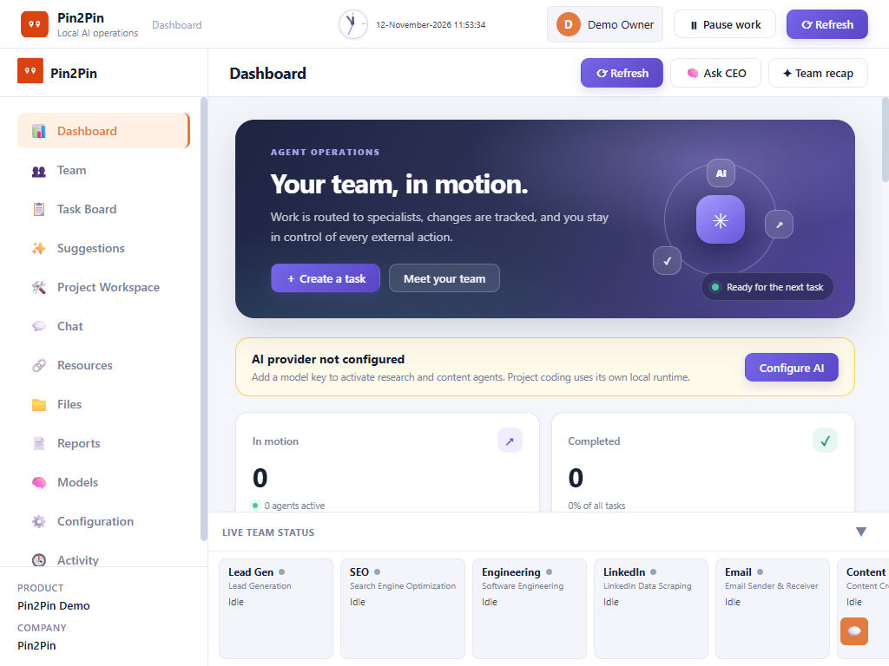

# Pin2Pin

Pin2Pin is a local-first AI operations dashboard. Create a company profile, assign work
to specialist agents, schedule recurring tasks, review deliverables, and keep control of
connected services and external actions.

## What it does

- Runs its FastAPI service on `127.0.0.1` with a local SQLite database.
- Requires a local owner and company profile on first launch; Pin2Pin is the fixed
  dashboard name, while the company name is user-defined.
- Dispatches one work item at a time. Review and engineering handoffs hold the queue
  until the current item is resolved.
- Supports custom specialist agents with editable job titles and instructions. Deleting
  an agent preserves task history and is blocked while it has open work; the CEO role
  remains available for coordination.
- Supports daily and weekly agent schedules in the computer's local time. If Pin2Pin is
  closed at the scheduled time, that run is skipped rather than replayed later.
- Keeps owner approval in the loop for external actions such as sending email or
  publishing a connected Telegram post.
- Uses real configured model providers; it does not simulate model results.

## Dashboard preview



## Run on Windows

Requires Python 3.10+ and internet access to install dependencies and use cloud models.

1. Run `setup.bat` once. It creates a project-local virtual environment and installs the
   Python dependencies.
2. Run `start_app.bat`.
3. Open `http://127.0.0.1:8000` and complete the local profile setup.
4. Configure an AI provider under **Configuration** before assigning model-based work.

The app binds to loopback only and has no multi-user authentication. Do not expose the
service to a network or change the bind address without adding suitable authentication
and access controls.

## Model providers

The Configuration page supports OpenRouter, Claude (Anthropic), OpenAI, OpenAI Codex
API, xAI/Grok, Groq, Google Gemini, Mistral, Hugging Face, DeepInfra, NVIDIA NIM, and
Together AI. OpenRouter model discovery can include Hermes models. The local Codex CLI
is a separate option for project-editing tasks in **Project Workspace**.

The **Models** page lets you choose Google Gemini or deAPI.ai independently for image
and video generation. Gemini remains the default and uses the existing model IDs; its
compatible discovered model IDs are offered as suggestions. Add and test a deAPI key
under Configuration to discover account-enabled media models. Text-only models are
not treated as media generators. Explicit media requests get a specific prompt prepared
before generation, and returned assets are saved locally in **Files**. Media generation
may consume provider credits. A media failure is recorded separately from the requested
text deliverable so a failed video call does not erase a report or script.

Blocked, rejected, and completed task cards include a task-only conversation. Ask about
the result there, reply to individual messages, or say “resume from last” to continue the
same task with the prior output retained in task history. The Task Board shows all active
work and the latest seven completed, rejected, and blocked tasks in each status.

Project Workspace streams Engineering run logs and includes a private chat with
Engineering. Select **Ask Engineering** beside a log line to discuss it; direct code
changes requested in that chat are queued as normal project tasks and verified by the
background Engineering worker.

Provider availability, model access, and pricing are controlled by each provider and
account. An API key may incur charges; Pin2Pin does not promise that any model or API
is free. Keys are stored locally in the ignored `backend/.env` file and are never
returned by the configuration API. Prompts and related task content sent to a
configured cloud model provider leave the computer and are handled under that
provider's terms and privacy policy.

## Local data and GitHub safety

Runtime data stays under `backend/`:

- `team.db` — profile, tasks, schedules, agents, and resource metadata
- `.env` — provider and service credentials
- `files/`, `credentials/`, `conversations/` — generated files and local service state

These paths are excluded by `.gitignore`. Do not force-add them to a commit or publish
personal databases, OAuth credentials, API keys, generated reports, or conversation
history. Keep a separate backup before reinstalling or moving the project.

Google, Gmail, and Telegram features require the user's own service setup and
authorization. A saved resource URL alone does not mean access is connected. Instagram,
LinkedIn, and other services are not represented as connected unless a supported
connector verifies the account; do not assume an API key alone grants platform
permissions.

## Development and tests

From the project root:

```powershell
.\venv\Scripts\python.exe -m unittest discover -s tests -p "test_*.py"
node --check frontend/static/js/app.js
```

The tests use temporary databases and mock external services; they do not require
live model credentials. GitHub Actions runs the complete test suite on Windows
for supported Python versions on pushes and pull requests using
`python -m unittest discover -s tests -p "test_*.py"`.

## Known limitations

The setup scripts currently target Windows only. Pin2Pin is single-user and has no
login. Cloud AI providers receive the task prompts and related content sent to them.

## Security

Pin2Pin is built for a single user on a trusted local computer. The service binds to
`127.0.0.1` and has no multi-user login. Do not expose it to a LAN, public internet,
reverse proxy, or shared host without first adding authentication, authorization,
CSRF protection, and an appropriate security review.

Host and Origin checks reduce browser-based risk but do not replace authentication; see
[SECURITY.md](./SECURITY.md).

**Request protection:** Host and Origin checks prevent other websites from submitting
requests to the local API. This does not provide a login or protect an instance exposed
to other devices or networks.

Keep API keys and service credentials in `backend/.env`. The database, credentials,
conversations, generated files, and agent memory are local runtime data and are
excluded by `.gitignore`. Never force-add them to a public repository. If a
credential is accidentally published, revoke it with the provider immediately;
deleting the file in a later commit does not erase it from Git history.

See [SECURITY.md](./SECURITY.md) for additional guidance.

## License

Pin2Pin is licensed under the MIT License. See [LICENSE](./LICENSE).
